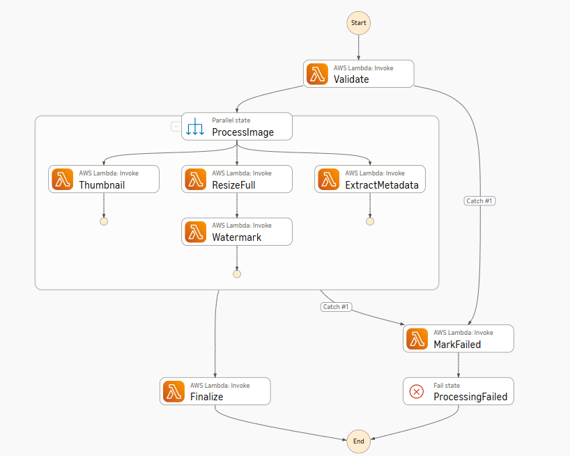
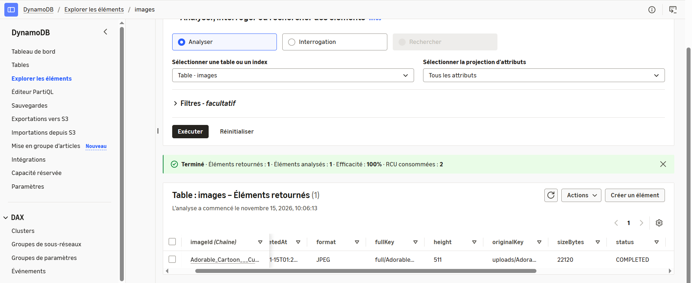
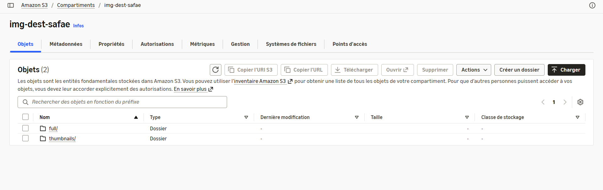
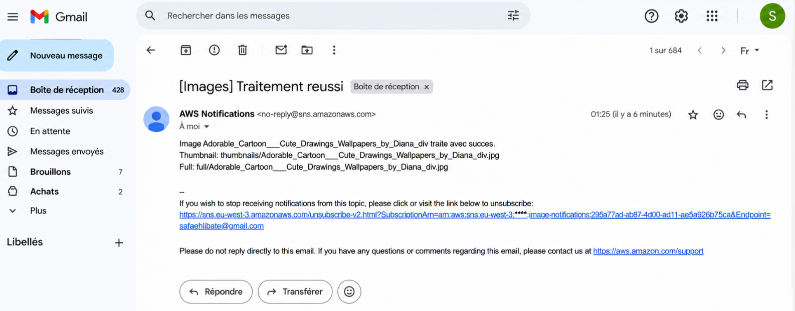

# Serverless Image Processing Pipeline

Ce projet est un pipeline de traitement d'images entièrement serverless sur AWS. Quand une image est déposée dans S3, un message est envoyé dans SQS, puis Step Functions orchestre le traitement : validation, miniature, redimensionnement, watermark et extraction des métadonnées. CloudFront sert ensuite les images, DynamoDB garde le statut de chacune, et SNS m'envoie un email à la fin.

**Région** : eu-west-3 (Paris)

## Progression

### Étape 1 : Buckets S3
J'ai créé deux buckets : `img-source-safae` pour les images envoyées, et `img-dest-safae` pour les images traitées. L'accès public est bloqué sur les deux.

Chaque bucket a aussi une policy `DenyInsecureTransport`, qui refuse tout accès en HTTP non chiffré (`infra/s3-source-bucket-policy.json` et `infra/s3-dest-bucket-policy.json`).

### Étape 2 : DynamoDB
J'ai créé la table `images` (clé de partition `imageId`, mode à la demande). Pour chaque image, elle garde son statut (`PENDING_UPLOAD`, `PROCESSING`, `COMPLETED` ou `FAILED`), ses dimensions, et les chemins S3 de l'original, de la miniature et de la version finale.

### Étape 3 : SNS
J'ai créé la rubrique `image-notifications` et je m'y suis abonnée par email. À la fin du traitement de chaque image, je reçois un message qui m'indique si ça a réussi ou échoué.
### Étape 4 : SQS + DLQ
- `image-processing-queue` : délai de visibilité 180 s, DLQ après 3 réceptions.
- `image-processing-dlq` : reçoit les messages en échec.
- Access policy : autorise uniquement le bucket source à envoyer des messages (`infra/sqs-access-policy.json`).
### Étape 5 : Rôle IAM
Rôle `image-pipeline-lambda-role` partagé par les 3 Lambdas : logs CloudWatch + accès S3, DynamoDB, SNS, SQS et démarrage de Step Functions (`infra/iam-lambda-policy.json`). *Amélioration : un rôle par fonction (moindre privilège).*
### Étape 6 : Lambda Layer Pillow
Pillow est compilé pour Linux : le Layer `pillow-layer` est construit dans CloudShell (`scripts/build-layer.sh`) et partagé par `image-worker` sans l'embarquer dans le package de la fonction.
### Étape 7 : Lambda image-worker
Python 3.12, 1024 Mo, timeout 1 min, Layer Pillow. Une seule fonction avec un paramètre `action` : `validate`, `thumbnail`, `resize`, `watermark`, `metadata`, `finalize`, `failed` (`src/image_worker/lambda_function.py`). Les images qu'elle produit (miniature et version complète) seront enregistrées dans le bucket destination avec un en-tête `Cache-Control: immutable`, pour que CloudFront puisse les garder longtemps en cache.
### Étape 8 : Step Functions
Workflow Standard `image-pipeline` : **Validate** (retry sur erreurs Lambda) → **Parallel** (Thumbnail | Resize → Watermark | Metadata) → **Finalize**. Toute erreur passe par **MarkFailed** (statut FAILED + email) puis **Fail** (`infra/state-machine.asl.json`).

### Étape 9 : Lambda `start-workflow` et déclencheur SQS
J'ai créé `start-workflow` pour faire le lien entre la file SQS et Step Functions. Elle ne traite aucune image elle-même : son seul travail est de lancer le workflow.

Un déclencheur SQS (batch size 1) l'appelle pour chaque message de `image-processing-queue`. Son code (`src/start_workflow/lambda_function.py`) lit la notification S3 contenue dans le message, en extrait le nom du bucket et le chemin du fichier, puis démarre une exécution du workflow `image-pipeline`.

Si la fonction échoue, le message n'est pas perdu : il revient dans la file et est retenté. Après 3 tentatives, il part dans la DLQ. J'ai aussi réglé le timeout de la fonction (30 s) bien en dessous du délai de visibilité de la file (180 s), pour qu'un message en cours de traitement ne réapparaisse pas trop tôt.
### Étape 10 : Notification S3 vers SQS
J'ai configuré le bucket source pour qu'il prévienne le reste du pipeline dès qu'une image arrive. À chaque fichier ajouté dans le dossier `uploads/`, S3 dépose un message dans la file `image-processing-queue`.

J'ai limité la notification au préfixe `uploads/` pour que seuls les vrais uploads déclenchent un traitement, et pas n'importe quel autre fichier du bucket. Pour que S3 ait le droit d'écrire dans la file, la policy d'accès SQS de l'étape 4 autorise uniquement ce bucket à lui envoyer des messages.

C'est le début de l'architecture événementielle : l'upload ne lance pas le traitement directement. Il laisse un message dans SQS, qui sera lu ensuite par `start-workflow`.
### Étape 11 : Premier test de bout en bout
J'ai déposé une photo dans le dossier `uploads/` depuis la console S3, puis j'ai attendu pour voir si le pipeline réagissait tout seul. Je n'ai rien lancé à la main, et tout s'est déclenché dès l'upload.

Dans Step Functions, le workflow est allé jusqu'au bout et toutes les étapes sont passées au vert :

Côté DynamoDB, une ligne a été créée pour mon image. Elle est passée au statut `COMPLETED`, avec sa largeur et sa hauteur :

Dans le bucket destination, les deux versions sont bien là : la miniature dans `thumbnails/` et la grande image dans `full/` :

J'ai ouvert l'image de `full/` pour vérifier le watermark, et le texte apparaît bien en bas à droite :

Et pour finir, j'ai reçu l'email de SNS qui m'annonçait que le traitement était terminé :

