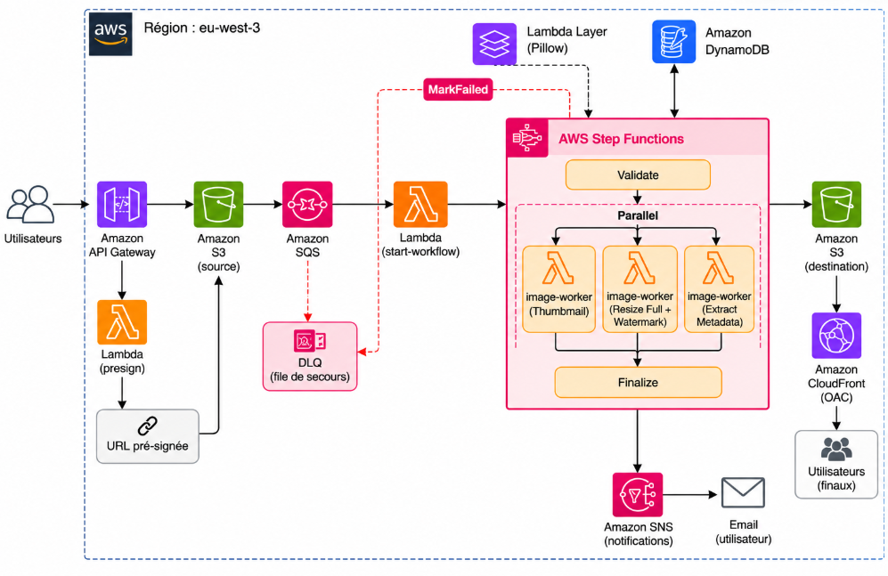
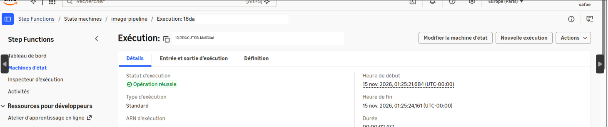
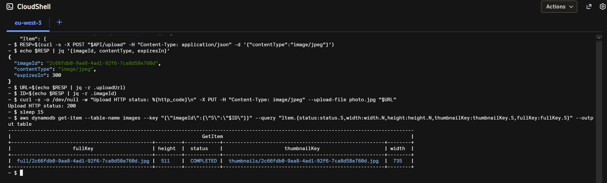
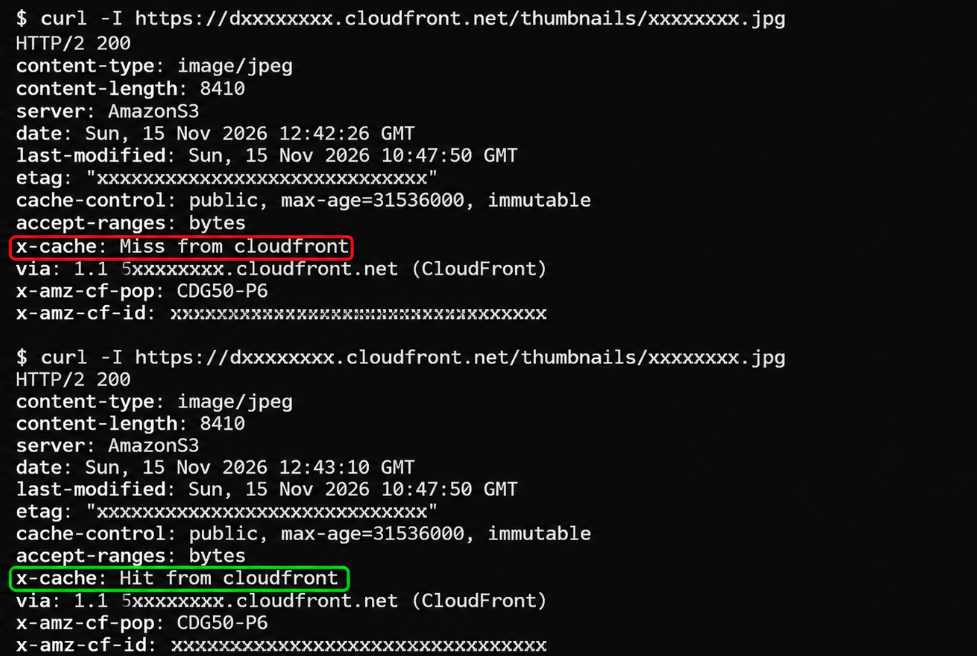
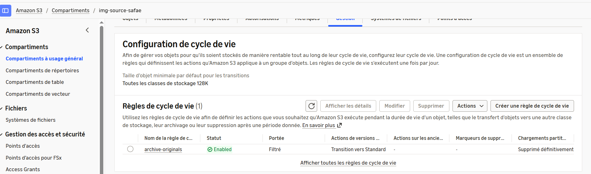

# Serverless Image Processing Pipeline with S3, SQS & Lambda
 
Ce projet est un pipeline de traitement d'images entièrement serverless sur AWS. Quand une image est déposée dans S3, un message est envoyé dans SQS, puis Step Functions orchestre le traitement : validation, miniature, redimensionnement, watermark et extraction des métadonnées. CloudFront sert ensuite les images, DynamoDB garde le statut de chacune, et SNS m'envoie un email à la fin.
 

 
**Région** : eu-west-3 (Paris)
 
## Sommaire
 
1. [Objectif du projet](#objectif-du-projet)
2. [Architecture et fonctionnement](#architecture-et-fonctionnement)
3. [Technologies utilisées](#technologies-utilisées)
4. [Structure du dépôt](#structure-du-dépôt)
5. [Détails de configuration](#détails-de-configuration)
6. [Sécurité](#sécurité)
7. [Réalisation pas à pas](#réalisation-pas-à-pas)
8. [Tests réalisés](#tests-réalisés)
9. [Ce que j'ai appris](#ce-que-jai-appris)
10. [Limites actuelles et améliorations possibles](#limites-actuelles-et-améliorations-possibles)
11. [Nettoyage des ressources](#nettoyage-des-ressources)
## Objectif du projet
 
Je voulais construire une architecture orientée événements, de l'upload d'une image jusqu'à sa diffusion, sans gérer le moindre serveur. Ce projet m'a permis de travailler les points suivants :
 
- concevoir une architecture événementielle avec les notifications S3 et SQS ;
- comprendre pourquoi le découplage par SQS rend le système plus résilient (retries, dead-letter queue) ;
- packager une dépendance lourde (Pillow) dans un Lambda Layer ;
- orchestrer un workflow en plusieurs étapes avec Step Functions ;
- appliquer des règles de cycle de vie S3 pour réduire les coûts de stockage ;
- servir les images traitées avec CloudFront et un cache adapté, en gardant le bucket privé.
## Architecture et fonctionnement
 
Voici le parcours complet d'une image, de l'upload à la diffusion :
 
| # | Étape | Ce qui se passe |
|---|---|---|
| 1 | Demande d'URL | Le client appelle `POST /upload` sur API Gateway, qui déclenche la Lambda `presign`. |
| 2 | Enregistrement | La Lambda crée une ligne dans DynamoDB (`PENDING_UPLOAD`) et renvoie une URL pré-signée. |
| 3 | Upload | Le client envoie l'image directement dans le bucket source, dossier `uploads/`. |
| 4 | Événement | S3 envoie un message dans la file SQS. Après 3 réceptions échouées, il part dans la DLQ. |
| 5 | Démarrage | La Lambda `start-workflow` lit la file et démarre le workflow Step Functions. |
| 6 | Traitement | Validation, puis en parallèle miniature, redimensionnement + watermark, et métadonnées, puis finalisation. |
| 7 | Résultats | Les images sont écrites dans le bucket destination, le statut est mis à jour dans DynamoDB, et SNS envoie un email de succès ou d'échec. |
| 8 | Diffusion | CloudFront sert les images depuis le bucket destination, qui reste privé (OAC). |
 
## Technologies utilisées
 
| Catégorie | Technologie | Rôle dans le projet |
|---|---|---|
| Stockage | Amazon S3 | Bucket source (originaux) et bucket destination (images traitées), notifications d'événements, bucket policies, règles de cycle de vie |
| Messagerie | Amazon SQS + Dead-Letter Queue | Découple l'upload du traitement, gère les retries, conserve les messages en échec |
| Calcul | AWS Lambda | Trois fonctions : `presign`, `start-workflow` et `image-worker` |
| Dépendances | Lambda Layer | Fournit la bibliothèque Pillow à `image-worker` |
| Orchestration | AWS Step Functions (Standard) | Enchaîne les étapes du traitement, avec Retry et Catch |
| API | Amazon API Gateway (HTTP API) | Expose `POST /upload` |
| Base de données | Amazon DynamoDB (mode à la demande) | Stocke le statut et les métadonnées de chaque image |
| CDN | Amazon CloudFront + Origin Access Control | Diffuse les images avec cache, bucket destination privé |
| Notifications | Amazon SNS | Email à la fin du traitement de chaque image |
| Sécurité et accès | AWS IAM | Rôle d'exécution des Lambdas, policies |
| Journalisation | Amazon CloudWatch Logs | Journaux des fonctions Lambda, utilisés pour le débogage |
| Langage et bibliothèques | Python 3.12, Pillow, boto3 | Code des trois Lambdas |
| Outils | AWS Management Console, AWS CloudShell, curl, jq | Création des ressources, construction du Layer, tests de l'API |
| Versionnement | Git, GitHub, VS Code | Suivi du code et de la documentation |
 
## Structure du dépôt
 
```
.
├── README.md
├── src/
│   ├── image_worker/lambda_function.py     # Traitement des images (Pillow)
│   ├── start_workflow/lambda_function.py   # SQS -> Step Functions
│   └── presign/lambda_function.py          # URL pré-signée d'upload
├── infra/
│   ├── state-machine.asl.json              # Définition du workflow Step Functions
│   ├── iam-lambda-policy.json              # Policy du rôle des Lambdas
│   ├── sqs-access-policy.json              # Autorise S3 à écrire dans la file
│   ├── s3-source-bucket-policy.json        # Bucket policy du bucket source
│   └── s3-dest-bucket-policy.json          # Bucket policy du bucket destination
├── scripts/
│   ├── build-layer.sh                      # Construction du Layer Pillow (CloudShell)
│   └── test-upload.sh                      # Test de bout en bout via l'API
└── docs/
    └── screenshots/                        # Captures d'écran des tests
```
 
Le numéro de mon compte AWS n'apparaît nulle part dans le dépôt : dans les fichiers de `infra/`, il est remplacé par `ACCOUNT_ID`.
 
## Détails de configuration
 
### Les trois fonctions Lambda
 
| Fonction | Rôle | Mémoire | Timeout | Layer | Déclencheur |
|---|---|---|---|---|---|
| `presign` | Génère l'URL pré-signée et crée la ligne DynamoDB | par défaut | 10 s | non | API Gateway (`POST /upload`) |
| `start-workflow` | Démarre le workflow à partir du message SQS | 128 Mo | 30 s | non | File SQS (batch size 1) |
| `image-worker` | Valide, redimensionne, ajoute le watermark, extrait les métadonnées | 1024 Mo | 1 min | `pillow-layer` | Step Functions |
 
Les trois utilisent Python 3.12 et le même rôle IAM, `image-pipeline-lambda-role`. `image-worker` est configurée avec quatre variables d'environnement : `TABLE_NAME`, `DEST_BUCKET`, `TOPIC_ARN` et `WATERMARK_TEXT`.
 
### Paramètres du traitement d'image
 
| Paramètre | Valeur |
|---|---|
| Formats acceptés | JPEG, PNG, WEBP |
| Taille maximale | 10 Mo (vérifiée à l'étape `Validate`) |
| Miniature | 300 px maximum, JPEG qualité 80, enregistrée dans `thumbnails/` |
| Version complète | 1920 px maximum, JPEG qualité 85, enregistrée dans `full/` |
| Watermark | Texte `(c) MonProjet`, en bas à droite de l'image `full/` |
| En-tête de cache | `Cache-Control: public, max-age=31536000, immutable` |
| Validité de l'URL pré-signée | 5 minutes |
 
### Les actions de `image-worker`
 
| Action | Ce qu'elle fait |
|---|---|
| `validate` | Contrôle la taille et le format, puis passe le statut à `PROCESSING` |
| `thumbnail` | Crée la miniature |
| `resize` | Crée la version complète |
| `watermark` | Ajoute le texte sur la version complète |
| `metadata` | Lit la largeur, la hauteur, le format et la taille |
| `finalize` | Passe le statut à `COMPLETED` et envoie l'email de succès |
| `failed` | Passe le statut à `FAILED` et envoie l'email d'échec |
 
### File SQS
 
| Paramètre | Valeur |
|---|---|
| Délai de visibilité | 180 s (au moins 6 fois le timeout de `start-workflow`) |
| Dead-letter queue | `image-processing-dlq` |
| Réceptions avant la DLQ | 3 |
 
### Table DynamoDB `images`
 
La clé de partition est `imageId` (chaîne). Les autres attributs sont ajoutés au fil du traitement :
 
| Attribut | Contenu | Écrit par |
|---|---|---|
| `imageId` | Identifiant unique de l'image | `presign` |
| `status` | `PENDING_UPLOAD`, `PROCESSING`, `COMPLETED` ou `FAILED` | `presign`, puis `image-worker` |
| `originalKey`, `sizeBytes` | Chemin et taille de l'original | `presign`, `validate` |
| `thumbnailKey`, `fullKey` | Chemins de la miniature et de la version complète | `finalize` |
| `width`, `height`, `format` | Dimensions et format de l'image | `finalize` |
| `uploadRequestedAt`, `validatedAt`, `completedAt`, `failedAt` | Dates des différentes étapes | `presign` et `image-worker` |
| `errorMessage` | Cause de l'erreur en cas d'échec | `failed` |
 
### Workflow Step Functions `image-pipeline`
 
| État | Type | Description |
|---|---|---|
| `Validate` | Task | Appelle `image-worker` (action `validate`). Retry : 3 tentatives, intervalle de 2 s, facteur 2. |
| `ProcessImage` | Parallel | Lance trois branches en même temps |
| `Thumbnail` | Task (branche 1) | Crée la miniature |
| `ResizeFull` puis `Watermark` | Task (branche 2) | Crée la version complète, puis y ajoute le watermark |
| `ExtractMetadata` | Task (branche 3) | Lit les métadonnées |
| `Finalize` | Task | Met à jour DynamoDB et envoie l'email de succès |
| `MarkFailed` puis `ProcessingFailed` | Task puis Fail | Atteints par `Catch` sur n'importe quelle erreur : statut `FAILED`, email, puis fin en échec |
 
## Sécurité
 
| Mesure | Mise en œuvre |
|---|---|
| Buckets privés | « Bloquer tous les accès publics » activé sur les deux buckets |
| Chiffrement en transit | Bucket policy `DenyInsecureTransport` : tout accès HTTP non chiffré est refusé |
| Upload sans credentials | URL pré-signée de 5 minutes, limitée à un fichier et à un type de contenu |
| Diffusion sans exposer le bucket | CloudFront avec Origin Access Control : seule ma distribution peut lire le bucket destination |
| Accès restreint à la file | Policy SQS : seul le bucket source, depuis mon compte, peut y envoyer des messages |
| Permissions IAM | Le rôle des Lambdas est limité aux actions nécessaires sur mes ressources (voir étape 5) |
| Identifiants | Aucun secret ni identifiant de compte dans le dépôt |
 
## Réalisation pas à pas
 
### Étape 1 : Buckets S3
J'ai créé deux buckets : `img-source-safae` pour les images envoyées, et `img-dest-safae` pour les images traitées. L'accès public est bloqué sur les deux.
 
Chaque bucket a aussi une policy `DenyInsecureTransport`, qui refuse tout accès en HTTP non chiffré (`infra/s3-source-bucket-policy.json` et `infra/s3-dest-bucket-policy.json`).
 
### Étape 2 : DynamoDB
J'ai créé la table `images` (clé de partition `imageId`, mode à la demande). Pour chaque image, elle garde son statut (`PENDING_UPLOAD`, `PROCESSING`, `COMPLETED` ou `FAILED`), ses dimensions, et les chemins S3 de l'original, de la miniature et de la version finale.
 
Le mode à la demande me convient bien ici : le trafic est irrégulier, je n'ai donc pas à réserver de capacité à l'avance.
 
### Étape 3 : SNS
J'ai créé la rubrique `image-notifications` et je m'y suis abonnée par email. À la fin du traitement de chaque image, je reçois un message qui m'indique si ça a réussi ou échoué.
 
### Étape 4 : SQS + DLQ
J'ai créé deux files : `image-processing-queue` (la file principale) et `image-processing-dlq` (la dead-letter queue). Je l'ai configurée avec un délai de visibilité de 180 secondes et un renvoi vers la DLQ après 3 réceptions.
 
Une policy d'accès autorise uniquement le bucket source à envoyer des messages dans la file (`infra/sqs-access-policy.json`). Sans elle, S3 ne peut pas écrire dans la file et la notification de l'étape 10 est refusée.
 
### Étape 5 : Rôle IAM
J'ai créé un seul rôle, `image-pipeline-lambda-role`, partagé par les trois Lambdas. Il combine la policy gérée `AWSLambdaBasicExecutionRole` (journaux CloudWatch) et une policy en ligne (`infra/iam-lambda-policy.json`) :
 
| Service | Actions autorisées | Ressource |
|---|---|---|
| S3 | `GetObject`, `PutObject` | Objets des deux buckets |
| DynamoDB | `PutItem`, `UpdateItem`, `GetItem` | Table `images` |
| SNS | `Publish` | Rubrique `image-notifications` |
| SQS | `ReceiveMessage`, `DeleteMessage`, `GetQueueAttributes` | File `image-processing-queue` |
| Step Functions | `StartExecution` | Machine d'état `image-pipeline` |
 
*Amélioration : un rôle par fonction (moindre privilège).*
 
### Étape 6 : Lambda Layer Pillow
Pillow est compilé pour Linux : le Layer `pillow-layer` est construit dans CloudShell (`scripts/build-layer.sh`) et partagé par `image-worker` sans l'embarquer dans le package de la fonction.
 
Je l'ai installé avec `pip` en ciblant la plateforme `manylinux2014_x86_64` et Python 3.12, puis publié avec `aws lambda publish-layer-version` (compatible Python 3.12 et architecture x86_64). Je l'ai construit dans CloudShell plutôt que sur mon ordinateur pour que les binaires correspondent à l'environnement de Lambda.
 
### Étape 7 : Lambda image-worker
Python 3.12, 1024 Mo, timeout 1 min, Layer Pillow. Une seule fonction avec un paramètre `action` : `validate`, `thumbnail`, `resize`, `watermark`, `metadata`, `finalize`, `failed` (`src/image_worker/lambda_function.py`). Les images qu'elle produit (miniature et version complète) seront enregistrées dans le bucket destination avec un en-tête `Cache-Control: immutable`, pour que CloudFront puisse les garder longtemps en cache.
 
J'ai choisi une seule fonction pour tout le traitement afin de simplifier le déploiement. J'ai donné 1024 Mo de mémoire parce que Pillow charge l'image entière en mémoire et que la puissance de calcul de Lambda augmente avec la mémoire. J'ai testé la fonction seule avec un événement `{"action": "unknown"}` : l'erreur `KeyError` obtenue confirmait que le code et Pillow se chargeaient bien.
 
### Étape 8 : Step Functions
Workflow Standard `image-pipeline` : **Validate** (retry sur erreurs Lambda) → **Parallel** (Thumbnail | Resize → Watermark | Metadata) → **Finalize**. Toute erreur passe par **MarkFailed** (statut FAILED + email) puis **Fail** (`infra/state-machine.asl.json`).
 
J'ai utilisé un workflow Standard pour avoir l'historique détaillé de chaque exécution. Les trois branches parallèles réduisent le temps total, car la miniature, la version complète et les métadonnées sont indépendantes. En revanche, le watermark dépend du redimensionnement : ces deux étapes sont donc enchaînées dans la même branche.
 

 
### Étape 9 : Lambda `start-workflow` et déclencheur SQS
J'ai créé `start-workflow` pour faire le lien entre la file SQS et Step Functions. Elle ne traite aucune image elle-même : son seul travail est de lancer le workflow.
 
Un déclencheur SQS (batch size 1) l'appelle pour chaque message de `image-processing-queue`. Son code (`src/start_workflow/lambda_function.py`) lit la notification S3 contenue dans le message, en extrait le nom du bucket et le chemin du fichier, puis démarre une exécution du workflow `image-pipeline`.
 
Si la fonction échoue, le message n'est pas perdu : il revient dans la file et est retenté. Après 3 tentatives, il part dans la DLQ. J'ai aussi réglé le timeout de la fonction (30 s) bien en dessous du délai de visibilité de la file (180 s), pour qu'un message en cours de traitement ne réapparaisse pas trop tôt.
 
### Étape 10 : Notification S3 vers SQS
J'ai configuré le bucket source pour qu'il prévienne le reste du pipeline dès qu'une image arrive. À chaque fichier ajouté dans le dossier `uploads/`, S3 dépose un message dans la file `image-processing-queue`.
 
J'ai limité la notification au préfixe `uploads/` pour que seuls les vrais uploads déclenchent un traitement, et pas n'importe quel autre fichier du bucket. Pour que S3 ait le droit d'écrire dans la file, la policy d'accès SQS de l'étape 4 autorise uniquement ce bucket à lui envoyer des messages.
 
C'est le début de l'architecture événementielle : l'upload ne lance pas le traitement directement. Il laisse un message dans SQS, qui sera lu ensuite par `start-workflow`.
 
### Étape 11 : Premier test de bout en bout
J'ai déposé une photo dans le dossier `uploads/` depuis la console S3, puis j'ai attendu pour voir si le pipeline réagissait tout seul. Je n'ai rien lancé à la main, et tout s'est déclenché dès l'upload.
 
Dans Step Functions, le workflow est allé jusqu'au bout et toutes les étapes sont passées au vert :
 

 
Côté DynamoDB, une ligne a été créée pour mon image. Elle est passée au statut `COMPLETED`, avec sa largeur et sa hauteur :
 

 
Dans le bucket destination, les deux versions sont bien là : la miniature dans `thumbnails/` et la grande image dans `full/` :
 

 
J'ai ouvert l'image de `full/` pour vérifier le watermark, et le texte apparaît bien en bas à droite :
 

 
Et pour finir, j'ai reçu l'email de SNS qui m'annonçait que le traitement était terminé :
 

 
### Étape 12 : API pour envoyer les images
Jusqu'ici, je déposais les images à la main dans la console S3. Pour que n'importe quel client puisse en envoyer une, j'ai construit une petite API.
 
J'ai d'abord créé une Lambda, `presign` (`src/presign/lambda_function.py`). Quand elle reçoit une demande, elle fait quatre choses : elle vérifie que le type de fichier est accepté (JPEG, PNG ou WEBP), elle génère un identifiant unique pour l'image, elle crée une ligne dans DynamoDB avec le statut `PENDING_UPLOAD`, puis elle renvoie une URL pré-signée. Cette URL est une adresse S3 temporaire, valable 5 minutes, qui autorise l'envoi d'un seul fichier à un emplacement précis de `uploads/`. Elle lit le nom du bucket et de la table dans ses variables d'environnement (`SOURCE_BUCKET` et `TABLE_NAME`).
 
Ensuite, j'ai créé une API HTTP dans API Gateway, `image-upload-api`, avec une seule route, `POST /upload`, branchée sur cette Lambda. J'ai laissé le déploiement automatique activé sur l'étape `$default`, pour que chaque modification soit publiée sans action de ma part.
 
Le client n'envoie donc jamais son image à mon API : il demande d'abord une URL, puis il envoie son image directement à S3. Le bucket reste privé, personne n'a d'accès permanent, et les gros fichiers ne passent ni par Lambda ni par API Gateway. Le dépôt de l'image dans `uploads/` déclenche ensuite tout le pipeline des étapes précédentes.
 
### Étape 13 : Test de bout en bout via l'API
Cette fois, j'ai testé le pipeline comme le ferait un vrai client, depuis CloudShell, sans toucher à la console S3. J'ai demandé une URL d'upload à mon API (`POST /upload`), j'ai envoyé une photo directement à S3 avec cette URL, puis j'ai interrogé DynamoDB pour voir où en était le traitement (`scripts/test-upload.sh`).
 
L'API m'a renvoyé un identifiant d'image, S3 a accepté l'upload (code HTTP 200), et quelques secondes plus tard la ligne de DynamoDB est passée à `COMPLETED`, avec les dimensions de l'image et les chemins de la miniature et de la version complète :
 

 
### Étape 14 : CloudFront
J'ai créé une distribution CloudFront devant le bucket destination, avec le forfait Gratuit (0 $/mois). L'origine est l'adresse S3 du bucket (`img-dest-safae.s3.eu-west-3.amazonaws.com`) et j'ai activé l'accès au bucket privé via Origin Access Control (OAC).
 
| Réglage | Valeur |
|---|---|
| Forfait | Gratuit (0 $/mois) |
| Origine | Bucket `img-dest-safae` (bucket privé) |
| Accès à l'origine | Origin Access Control (OAC) |
| Protocole | HTTP redirigé vers HTTPS |
| Politique de cache | `Managed-CachingOptimized` |
 
Le bucket destination reste donc **privé** : CloudFront a ajouté à sa bucket policy une règle (`AllowCloudFrontServicePrincipal`) qui autorise la lecture des objets uniquement pour ma distribution, à côté de la règle `DenyInsecureTransport`. Les objets ont `Cache-Control: immutable` et des noms uniques : pas d'invalidation nécessaire.
 
Pour tester le cache, j'ai demandé deux fois la même miniature à CloudFront. La première réponse est servie depuis l'origine (`Miss`), la seconde directement depuis le cache de CloudFront (`Hit`) :
 

 
### Étape 15 : Gestion du cycle de vie S3
 
Des règles Lifecycle ont été mises en place sur les deux buckets afin d'automatiser la gestion des fichiers et d'optimiser le stockage.
 
| Bucket | Préfixe | Règle |
|---|---|---|
| Source | `uploads/` | Passage en classe Standard-IA après 30 jours, suppression après 365 jours, suppression des chargements multipart incomplets après 7 jours |
 
- **Bucket source (`uploads/`)** : les images originales passent en classe Standard-IA après 30 jours et sont supprimées après 365 jours. Les chargements multipart incomplets sont supprimés après 7 jours.
Les originaux sont rarement relus une fois traités : la classe Standard-IA coûte moins cher pour ce type d'accès, et la suppression évite d'accumuler des fichiers inutiles. Cette configuration permet de réduire les coûts de stockage et d'éviter l'accumulation de fichiers inutilisés.
 

 
## Tests réalisés
 
| Test | Méthode | Résultat observé |
|---|---|---|
| Upload manuel (étape 11) | Dépôt d'une photo JPG dans `uploads/` via la console S3 | Exécution Step Functions réussie, ligne `COMPLETED` dans DynamoDB, fichiers dans `thumbnails/` et `full/`, watermark visible, email SNS reçu |
| Upload via l'API (étape 13) | `POST /upload` puis `PUT` sur l'URL pré-signée, depuis CloudShell avec `curl` et `jq` | Code HTTP 200 sur l'upload, statut `COMPLETED` dans DynamoDB |
| Cache CloudFront (étape 14) | Deux requêtes `curl -I` sur la même miniature | `Miss` puis `Hit` |
 
## Ce que j'ai appris
 
- **Pourquoi SQS ?** SQS permet de séparer le stockage des images sur S3 de leur traitement. Cela facilite la gestion des pics de charge et permet de relancer automatiquement les traitements en cas d'échec. Les messages qui échouent plusieurs fois sont envoyés dans la DLQ au lieu d'être perdus.
- **Pourquoi utiliser un Lambda Layer ?** Pillow est une bibliothèque assez volumineuse. Je l'ai donc placée dans un Layer séparé plutôt que de l'intégrer dans chaque package Lambda. Cela simplifie la gestion des dépendances et leur réutilisation.
- **Pourquoi Step Functions ?** Step Functions permet de visualiser et d'organiser les différentes étapes du traitement. Il facilite aussi la gestion des erreurs grâce aux mécanismes Retry et Catch, tout en conservant un historique des exécutions utile pour le débogage.
- **Règles Lifecycle S3 :** Elles automatisent la gestion des fichiers stockés en transférant les anciens objets vers Standard-IA, puis en les supprimant selon la durée de conservation définie.
- **CloudFront avec OAC :** Cette configuration permet de garder le bucket de destination privé tout en distribuant les images via le réseau mondial de CloudFront. Le système de cache améliore également les temps de chargement.
- **URL pré-signées :** Elles permettent au client d'envoyer directement les images vers S3 sans avoir besoin de credentials AWS. Les données de l'image ne transitent donc pas par Lambda.
## Limites actuelles et améliorations possibles
 
Le projet fonctionne, mais certains points pourraient être améliorés avant une utilisation en production :
 
| Point | Situation actuelle | Amélioration possible |
|---|---|---|
| Permissions IAM | Un rôle partagé par les trois Lambdas | Un rôle distinct par fonction, avec uniquement les permissions nécessaires |
| Sécurité de l'API | API publique, sans authentification | Amazon Cognito ou un authorizer, avec limitation du nombre de requêtes (*throttling*) |
| Taille des fichiers | Limite de 10 Mo vérifiée après l'envoi | URL pré-signée de type POST avec la condition `content-length-range`, pour contrôler la taille au moment de l'upload |
| Infrastructure as Code | Ressources créées à la main dans la console | Terraform, AWS CDK ou SAM pour déployer et reproduire l'architecture |
| Watermark | Simple texte | Logo au format PNG pour un rendu plus personnalisé |
 
## Nettoyage des ressources
 
Une fois mes tests et mes captures terminés, j'ai supprimé toutes les ressources AWS créées pour ce projet afin d'éviter des coûts inutiles : la distribution CloudFront, le contenu et les deux buckets S3, l'API, les trois fonctions Lambda et le Layer, le workflow Step Functions, les deux files SQS, la rubrique SNS, la table DynamoDB, les journaux CloudWatch et les rôles IAM. Tout le code et les fichiers de configuration restent dans ce dépôt, ce qui permet de recréer l'architecture.
 